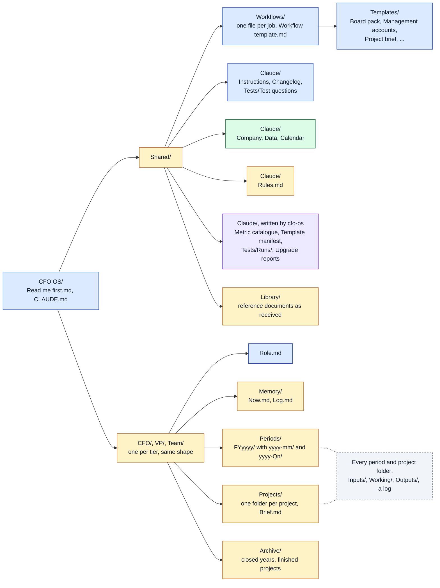

# cfo-ai-os

A folder template that lets Claude work as a finance analyst for a finance team, reading figures from a finance data connector and keeping its memory in plain Markdown files.

A personal project by Patrick Bowyer. Not an official Datarails product and not supported by Datarails. Datarails and FinanceOS are trademarks of their owner.

## What it is

- **A folder, `CFO OS`.** Plain Markdown files the team keeps in SharePoint, OneDrive or any shared synced location: what Claude knows about the company, one file per recurring job, output templates, and the work itself. It is laid out by access tier, `CFO`, `VP` and `Team`, so folder permissions decide who sees what. See [Roles and access](docs/roles.md).
- **A setup prompt, `SETUP.md`.** One file a person pastes into Claude. Claude checks it can write to the chosen location, asks a few questions, and writes the folder.
- **A small tool, `cfo-os`.** It deploys the folder from an answers file, upgrades a deployed folder without touching what people or Claude wrote, checks a folder against its filing rules, and builds the metric catalogue.
- **Skills, `cfo-os`.** A Claude plugin with skills for cash runway, variance analysis (with a price, volume and mix bridge) and forecast accuracy. Each does its arithmetic in a bundled script. See [Skills](docs/skills.md).

## Set up with one prompt

1. Connect your finance data connector to Claude.
2. Open a new chat and paste the whole of [`SETUP.md`](SETUP.md) as the first message.
3. Answer Claude's questions. It writes the folder to the shared location you name and gives you the one line to paste into the Claude Project's instructions.

Nothing needs to be installed. If Claude can run Python it uses the tool below; otherwise it writes the files itself.

## Set up or upgrade with the tool

For maintainers, and for every upgrade. Install Python 3.11 or later, then `pip install "git+https://github.com/PaddyB0/cfo-ai-os"` (or run `python run.py <command>` from a clone).

```
cfo-os deploy --answers answers.yaml --metrics metrics.json --target "<path>/CFO OS" --tiers CFO,VP,Team --deployer "Your Name"
cfo-os check --folder "<path>/CFO OS"
```

`--tiers` defaults to `CFO`. Start from the fictional `examples/answers.example.yaml` and `examples/metrics.example.json`. See [Deploy](docs/deploy.md).

To upgrade, dry run first, then apply:

```
cfo-os upgrade --folder "<path>/CFO OS"
cfo-os upgrade --folder "<path>/CFO OS" --apply
```

Only unedited template regions are replaced. Edited regions are reported for a person to merge, and files people or Claude wrote are never opened. A 0.2 folder cannot be upgraded in place; see [Upgrade](docs/upgrade.md).

## The folder

Colour shows who owns each part, which decides what `cfo-os upgrade` may change. See [Folder map](docs/folder-map.md).



- Blue, template-owned: written at deploy; upgrade replaces unedited template regions.
- Green, context: filled from the answers at deploy; upgrade never touches it.
- Purple, generated: written by `cfo-os`. Upgrade regenerates the catalogue only with `--catalogue`.
- Amber, the team's own: starter headers only, or created when first needed; upgrade never opens it.

## Who it is for

A CFO and their finance team who use Claude with a read-only finance data connector and want the work to be repeatable: the same rules, the same workflows, and a memory that survives from one chat to the next. It is connector-neutral; the first connector guide is for the Datarails FinanceOS connector.

## Install the skills

In Claude Code or Cowork:

```
/plugin marketplace add PaddyB0/cfo-ai-os
/plugin install cfo-os@cfo-ai-os
```

In the Claude desktop or web app, run `cfo-os skills --out "<path>/skills"` from the clone's root and upload each zip under Settings, Capabilities, Skills, with code execution turned on.

## Docs

- [Roles and access](docs/roles.md): the three tiers, the folder permissions to set, and what is and is not enforced.
- [Memory model](docs/memory-model.md): one home per kind of knowledge, and who writes what.
- [Working with a connector](docs/working-with-a-connector.md): scenarios and cycles, end-of-period metrics, declining what the data cannot answer.
- [Connector guide: Datarails FinanceOS](docs/connectors/datarails-financeos.md)
- [Folder map](docs/folder-map.md): the layout, the filing rules, ownership classes and template regions.
- [Deploy](docs/deploy.md), [Upgrade](docs/upgrade.md), [Writing a workflow](docs/writing-a-workflow.md), [Skills](docs/skills.md)

## Licence

Apache-2.0. See `LICENSE` and `NOTICE`. Contributions: see `CONTRIBUTING.md`. Security and data leaks: see `SECURITY.md`.
